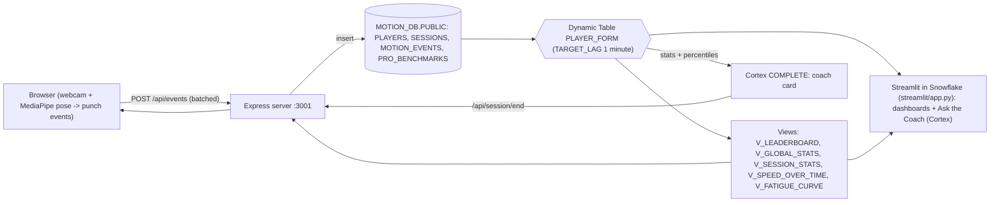

# Motion Boxing on Snowflake

Webcam boxing game: MediaPipe reads punches in the browser, every punch becomes a row in Snowflake, and Snowflake does the analytics and the AI coaching. Shared names (tables, endpoints, columns) are defined in `sql/CONTRACT.md`.

> **Team status (2026-11-21, backend / Person B).** The backend (`/server`, `/sql`, `/streamlit`, `/scripts`) is on `main` and passes all tests in mock mode. It has **not** run against a real Snowflake account yet: that needs credentials in `server/.env`.
>
> **Front end:** `src/api/serverAdapter.ts` (Naman, 24fc233) talks to the original API, and that works unchanged. The server also accepts the front end's own contract (`src/api/CONTRACT.md`) directly, so either client shape works. See "Connecting the front end" below.
>
> **Open asks from `src/api/CONTRACT.md`: all three are done.**
> 1. `slip` / `duck` are accepted event types. They are stored, but not counted as punches.
> 2. `/api/events` parses `text/plain` bodies (`sendBeacon`).
> 3. `payload.client_event_id` becomes the `event_id`, so retried or beaconed events are skipped instead of stored twice.
>
> Also: events tagged `payload.speed_unit: 'SW/s'` are converted to m/s (× `SHOULDER_WIDTH_M`, default 0.4), so speeds compare correctly with `PRO_BENCHMARKS`.
>
> **For the front end:**
> - Set `VITE_API_URL=http://localhost:3001` in the root `.env`. Port 3001 is our server, not the 8787 used in the contract example.
> - The adapter can now send DODGE as `event_type: 'slip'` or `'duck'` instead of dropping it.

## 1. Architecture



```
Browser+MediaPipe -> Express(:3001) -> MOTION_EVENTS -> PLAYER_FORM (DT, 1 min)
                                                    |-> Cortex COMPLETE -> coach card (in /api/session/end)
                                                    '-> Streamlit in Snowflake (+ Cortex "Ask the Coach")
```

Snowflake objects: database `MOTION_DB`, schema `PUBLIC`, warehouse `MOTION_WH`, role `MOTION_APP_ROLE`.

## 2. Setup (real Snowflake)

1. In a Snowsight worksheet as `ACCOUNTADMIN`, run `sql/setup.sql` (database, schema, warehouse, role, tables, seed benchmarks).
2. Still as `ACCOUNTADMIN`, run `sql/analytics.sql` (Dynamic Table `PLAYER_FORM` and the `V_*` views).
3. Create a service user for `MOTION_APP_ROLE` and attach an RSA public key (key-pair auth). Generate a key pair with `openssl`, then in SQL: `CREATE USER ...` with `DEFAULT_ROLE = MOTION_APP_ROLE`, `GRANT ROLE MOTION_APP_ROLE TO USER ...`, `ALTER USER ... SET RSA_PUBLIC_KEY='...'`. `setup.sql` does not create the user (a commented-out `CREATE USER` block is at the bottom). It does create `MOTION_APP_ROLE` (DML on the tables, SELECT on the views, `SNOWFLAKE.CORTEX_USER`) and `MOTION_READONLY_ROLE` (SELECT only, used by `/api/ask`); grant both roles to the user.
4. `cp server/.env.example server/.env` and fill in the values listed there (account, user, private key, role/warehouse/database). Use the variable names from that file as-is.
5. Install and run the server: `cd server && npm install && npm run dev` (scripts: `dev`, `build`, `start`, `start:mock`, `test`). It listens on port 3001; check `GET /api/health` returns `mode:'snowflake'`.
6. Seed demo data: `cd scripts && npm install && npm run seed` (flags: `--seed`, `--players`, `--sessions`, `--dry-run`, `--json out.json`, `--reset`, `--api URL`). It reads the same `SNOWFLAKE_*` env vars as the server.
7. Smoke test the API: `scripts/test-api.sh`.
8. Deploy Streamlit: create a Streamlit in Snowflake app from `streamlit/app.py` in Snowsight (Projects > Streamlit), using `MOTION_WH` and a role with access to `MOTION_DB`. Upload `app.py`, `logic.py` and `environment.yml` together (see `streamlit/README.md`).
9. Start the browser game: in the repo root, set `VITE_API_URL=http://localhost:3001` in `.env`, then `npm install && npm run dev` (http://localhost:5173, the CORS origin the server allows).

## Connecting the front end

The server accepts two request shapes on the same endpoints, so neither side has to change.

| | Front-end contract (`src/api/CONTRACT.md`) | Original backend API (`sql/CONTRACT.md`) |
|---|---|---|
| Ids | Client generates player/session/event UUIDs; the server creates the `PLAYERS` / `SESSIONS` rows on first sight (MERGE, insert-if-missing). | `POST /api/players`, then `POST /api/session/start`. |
| `POST /api/events` | `{"events":[...]}` or a bare array, as `application/json` or `text/plain` (beacon). Invalid events are dropped one by one, so one bad event never blocks the batch; a resent `event_id` is skipped. Reply `202 {accepted, queued, ignored, rejected, duplicates}`. | Bare array, JSON or `text/plain`; a bad batch gets a `400`. `payload.client_event_id` is used for de-duplication; `payload.speed_unit:'SW/s'` is converted to m/s. |
| `POST /api/session/end` | Full body (`display_name`, `final_score`, `result`, ...). Upserts the player name, stores the client summary in `SESSIONS.ai_coach_json:client`, and returns `{session_id, stats, coach:{headline, tips, drill:{name,description}, badge:{name,description}, summary}, leaderboard, form_score, fallback}`. | `{session_id}`, returns the string-valued coach card. |
| `GET /api/leaderboard` | Rows also carry `display_name`, `sport:"BOXING"` and `max_speed`. | `rank, player_id, name, score, fastest_punch, best_reaction_ms` |

How front-end events map to `MOTION_EVENTS` (`server/src/frontend.ts`):
- `PUNCH`: `event_type` = lower-cased `metrics.punchType` (`jab`/`cross`/`hook`/`uppercut`; missing means `jab`).
- `BLOCK`: `block`.
- `DODGE`: `duck` (if `metrics.kind` is `duck` or `metrics.direction` is `DOWN`), otherwise `slip`. Stored, but not counted as a punch.
- `TICK` and the other sports' types are not stored yet. They are counted as `ignored`.
- `hand` = `metrics.hand`.
- `speed_mps` = `peak_velocity` (shoulder-widths/s) × `SHOULDER_WIDTH_M` (default 0.4 m).
- `accuracy` = `accuracy_score / 100`.
- `guard_up` = `metrics.guardUp` (optional).
- `points` = `metrics.points` if sent; otherwise a landed punch scores 10 + 10 × accuracy, a missed punch (`landed:false`) 0, and a block or dodge 5. The Snowflake score is the sum of points.
- The original event (`round_ms`, `peak_velocity`, `accuracy_score`, `symmetry_ratio`, `metrics`) is kept in `MOTION_EVENTS.payload`, so nothing is lost.
- `form_score` = the player's mean percentile vs `PRO_BENCHMARKS` (0 to 100).

## Going live (one-time, about 10 minutes)

All commands run from the repo root. `server/.env` is git-ignored; never commit it.

1. `cp server/.env.example server/.env`. Set `SNOWFLAKE_MOCK=0`, `SNOWFLAKE_ACCOUNT` (`orgname-accountname`), `SNOWFLAKE_USER` and `SNOWFLAKE_PASSWORD`, or use `SNOWFLAKE_PRIVATE_KEY_PATH` instead of the password. For the first run, use a user that has `ACCOUNTADMIN`.
2. `cd scripts && npm ci && npm run sql:setup`. This runs `sql/setup.sql` and `sql/analytics.sql`, statement by statement, as ACCOUNTADMIN.
3. `npm run seed` (in `scripts/`) loads 20 players × 3 sessions. Then run `npm run sql:verify`.
4. `npm run cortex:latency` (in `scripts/`) times a cold and a warm Cortex COMPLETE.
5. `npm run server` (repo root) starts the API on http://localhost:3001. Check `GET /api/health` → `mode:"snowflake", snowflake:"up"`.
6. `scripts/test-api.sh` runs the end-to-end check against the live server.
7. `cd scripts && npm run streamlit:deploy` creates `MOTION_DB.PUBLIC.MOTION_DASHBOARD` and prints its Snowsight URL.

**Coach card latency.**
- `/api/session/end` always answers within `COACH_FAST_MS` (5 s).
- If Cortex is slower, the reply has `warming_up: true` and a provisional card. The real card is stored when it arrives; get it by polling `GET /api/session/:id/coach` until `ready: true`. That reply also includes `coach_card` in the front-end shape.
- At startup the server sends one tiny Cortex call (`CORTEX_WARMUP=1`).
- During the demo, set `WAREHOUSE_KEEPWARM_MS=240000` so `MOTION_WH` never auto-suspends. The warehouse is billed while it is resumed.

**Front end:** set `VITE_API_URL=http://localhost:3001` in the root `.env`. CORS allows `http://localhost:5173`.

## 3. Mock mode (no credentials)

Set `SNOWFLAKE_MOCK=1` (e.g. in `server/.env` or the shell). The server uses an in-memory repository and a canned Cortex reply, so every endpoint works offline. `GET /api/health` reports `mode:'mock'`.

```
npm run server:mock          # from the repo root (installs server deps on first run)
scripts/test-api.sh
```

`scripts/run-mock-e2e.sh` runs the end-to-end flow in mock mode. It starts the server with `SNOWFLAKE_MOCK=1`, waits for `/api/health`, seeds 5 players through the API, runs `scripts/test-api.sh` (original API plus front-end contract checks), and stops the server. Mock mode does not exercise Snowflake, Dynamic Tables, or Streamlit.

## 4. 30-second judge pitch

"Every punch the webcam detects becomes an event row in Snowflake: type, hand, speed, accuracy, reaction time, guard state. Those land in MOTION_EVENTS, and a Dynamic Table, PLAYER_FORM, refreshes with a one-minute target lag to roll them into per-player form: speed, fatigue drop from the first to the last quarter of a session, left-right symmetry, guard percentage. Plain SQL aggregates power the leaderboard and charts. We compare each player to a PRO_BENCHMARKS table to get a percentile per metric. When a round ends, we call Cortex COMPLETE with those stats and get back a structured coach card: three tips, a drill, and a badge. If Cortex is slow, a fallback card keeps the demo moving. The same data powers a Streamlit in Snowflake app with an 'Ask the Coach' box, also on Cortex, so there is no data movement out of Snowflake. It is cheap to run: an X-SMALL warehouse that auto-suspends after 300 seconds."

## 5. Snowflake Marketplace angle (optional, hypothetical, not implemented)

`PRO_BENCHMARKS` is currently a small table we seed ourselves. If a suitable free sports-science or boxing benchmark dataset were available on Snowflake Marketplace, it could replace those hand-picked percentiles with real reference data via a view mapped to the same columns (`sport, metric, p25, p50, p75, p90, pro_avg, higher_is_better`). We have not identified or integrated any such dataset.
