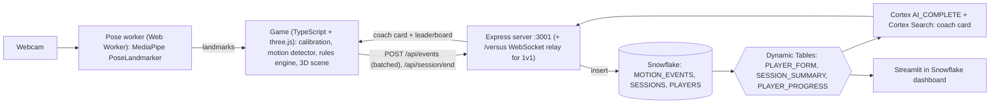

# Kinetic Ring

**Living-room motion sports, rebuilt for 2026: box, keep goal or fight a friend with just your laptop webcam, coached by Snowflake Cortex.**

No controller, no console, no sensors. Pose tracking runs in the browser, the video never leaves your device, and every punch becomes a row in Snowflake that powers your AI coach, the live leaderboard and a coaching dashboard.

## Features

- **Webcam boxing against a bot.** Jab, cross, hook and uppercut are classified live from 3D pose; block, slip and duck are detected too. The bot telegraphs its attacks, guards, sways and ducks. Combos, counters, guard stamina and a slow-motion KO.
- **Online 1v1 on two laptops.** A WebSocket relay pairs two players by a 4-letter room code. Each laptop owns its own health, so the screens never disagree. See `docs/VERSUS.md`.
- **Reflex Keeper (goalkeeper).** A second sport on the same pose pipeline: real ball physics, glove and body saves, reaction-time scoring.
- **AI coach card after every round.** Snowflake Cortex `AI_COMPLETE` returns a headline, 3 tips, a drill and a badge as schema-validated JSON, grounded in a drill library through Cortex Search. A local fallback card keeps the game going offline.
- **Live leaderboard and stats**, read from Snowflake views.
- **Coaching dashboard in Streamlit in Snowflake:** percentile against pro benchmarks, fatigue curve, left/right symmetry, punch mix, "Ask the Coach", plus a Snowflake Lab page (style twin with vectors, AI scouting report, Cortex Analyst questions, time travel).
- **Works without a camera or the internet:** keyboard and mouse modes, a demo round, and a mock backend.

## Architecture



1. **Pose worker** (`src/pose/`): MediaPipe PoseLandmarker runs in a Web Worker, so rendering never waits on inference. Frames go in as transferred `ImageBitmap`s and landmarks come back as packed arrays. A One Euro filter and a quality governor keep it smooth on slow laptops.
2. **Game** (`src/sports/`, `src/shell/`): calibration, a pure motion detector (punch type from elbow angle, shoulder yaw and torso-frame velocity), a deterministic rules engine, and a three.js scene. Events are batched with `sendBeacon` as a fallback.
3. **Express** (`server/`): validates and de-duplicates events, writes them behind a retrying queue, ends sessions, asks Cortex for the coach card, serves the leaderboard, and runs the 1v1 relay. It has a mock mode that needs no Snowflake.
4. **Snowflake** (`sql/`, `streamlit/`): tables, Dynamic Tables, Streams and Tasks (highlights, AI scouting), Cortex `AI_COMPLETE` / `AI_CLASSIFY` / Search / Analyst, vector similarity, and the Streamlit dashboard. Details: `docs/SNOWFLAKE.md`.

## Run it

You need **Node.js 22 or newer** and Chrome or Edge. The webcam only works on `http://localhost` or HTTPS.

### macOS

```bash
git clone https://github.com/rohansharmacode/motion-boxing
cd motion-boxing
npm install
echo "VITE_API_URL=http://localhost:3001" > .env
npm run server:mock      # terminal 1: API on :3001, no Snowflake needed
npm run dev              # terminal 2: game on http://localhost:5173
```

### Windows (PowerShell)

```powershell
git clone https://github.com/rohansharmacode/motion-boxing
cd motion-boxing
npm install
Set-Content .env "VITE_API_URL=http://localhost:3001"
npm run server:mock      # terminal 1
npm run dev              # terminal 2, then open http://localhost:5173
```

When Windows asks whether Node.js may use the network, allow **Private networks** (needed for 1v1).

### With real Snowflake

Copy `server/.env.example` to `server/.env`, fill in the `SNOWFLAKE_*` values (key-pair auth), then:

```bash
cd scripts && npm ci
npm run sql:setup && npm run sql:plus && npm run seed && npm run sql:verify:plus && npm run streamlit:deploy
cd .. && npm run server
```

Full runbook and troubleshooting: `docs/SNOWFLAKE.md`. Never commit `server/.env` or keys.

### Controls without a webcam

Boxing: **D** toggles keyboard mode (J jab, K cross, H hook, U uppercut, Shift or arrows to dodge), **M** plays a demo round. Reflex Keeper: **D** toggles mouse mode.

### Tests

```bash
npm test                     # game unit tests
npm --prefix server test     # API tests
bash scripts/test-api.sh     # end-to-end API check against a running server
```

### More docs

- `docs/DEMO.md`: the 3-minute demo script and fallback plan
- `docs/VERSUS.md`: 1v1 setup on two laptops
- `docs/HOSTING.md`: one-click hosting on Render
- `docs/SNOWFLAKE.md`: Snowflake features, runbook, cost
- `docs/DEVPOST.md`: the submission text

## Judging criteria

### Theme: "Rebuild something old for 2026"

Motion-controlled living-room sports needed a console, a sensor bar and a controller in your hand. We rebuilt the idea with things everyone already has in 2026: a laptop webcam, on-device pose AI in the browser, and a cloud data platform with built-in LLMs. No hardware, nothing to install for players, and an AI coach that reads your actual stats instead of a fixed score screen.

### Best Use of Snowflake

Snowflake is the game's analytics and coaching brain, not just storage:

- Every punch is a row in `MOTION_EVENTS`.
- **Dynamic Tables** (`PLAYER_FORM`, `SESSION_SUMMARY` to `PLAYER_PROGRESS`) roll punches into form and progress with `REGR_SLOPE` trends.
- **Cortex `AI_COMPLETE`** with a JSON schema writes the coach card, grounded with **Cortex Search** over our drill library (RAG).
- **Streams + Tasks** write a live highlights feed and run **`AI_CLASSIFY`** scouting reports in the background.
- **`VECTOR` + `VECTOR_COSINE_SIMILARITY`** find your "style twin".
- **Cortex Analyst** with a semantic model answers questions in plain English, and generated SQL runs under a SELECT-only role.
- **Streamlit in Snowflake** hosts the dashboard, so the data never leaves Snowflake.
- **Time Travel** rewinds the leaderboard.
- Cost controls: an X-Small warehouse with auto-suspend, and tasks that skip when no one is playing.

Screenshots from the live account: `docs/snowflake-screens/`.

### JetBrains Air usage

> **TODO (team):** describe how we used JetBrains Air during the hackathon: which parts it built or reviewed, a concrete example, and a screenshot. Only list what we actually did.

## Credits

- Fighter robot model: "RobotExpressive" by Tomás Laulhé (Quaternius), CC0 1.0, via the three.js examples (modified by Don McCurdy). `public/models/robot.glb`.
