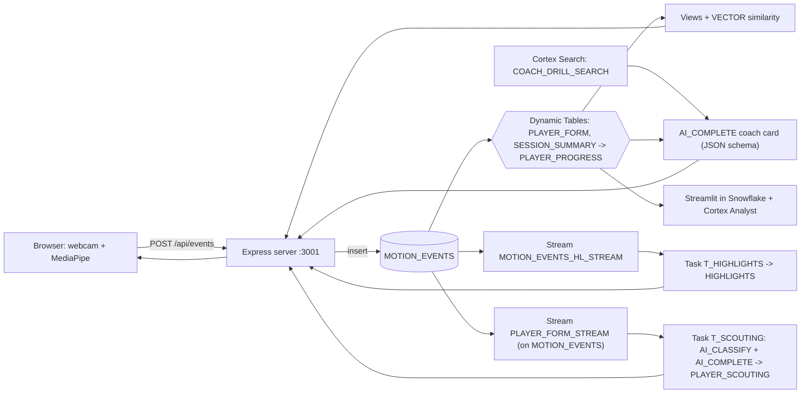

# Motion Boxing on Snowflake

Shared names live in `sql/CONTRACT.md` (core) and `sql/PLUS_CONTRACT.md` (new features).
Older setup notes: `README-snowflake.md`.

## For judges

You box at your webcam. The browser reads each punch with MediaPipe and sends it to our server.
Every punch becomes a row in `MOTION_DB.PUBLIC.MOTION_EVENTS`. From there Snowflake does all the work.
Dynamic Tables turn raw punches into form and progress. Streams and Tasks write a live highlights feed,
flag implausible punch speeds, and write AI scouting reports. Cortex writes your coach card as validated JSON,
grounded in a drill library through Cortex Search. Vectors find your "style twin". Cortex Analyst and a
Streamlit in Snowflake app let you ask questions about your stats in plain English.
The data never leaves Snowflake, and an idle game uses almost no compute: tasks skip and the warehouse auto-suspends.

Running live on a real Snowflake account (2026-11-21): every setup, verify and deploy step passes, and a played round lands in `MOTION_EVENTS` / `SESSIONS` with a real Cortex coach card (`fallback:false`). Screenshots: `docs/snowflake-screens/`.

| Snowflake feature | What it does in our game | Where to see it |
|---|---|---|
| Dynamic Tables | `PLAYER_FORM` rolls punches into per-player form (1 minute lag). `SESSION_SUMMARY` -> `PLAYER_PROGRESS` tracks improvement per session with `REGR_SLOPE`. | Snowsight object explorer: `MOTION_DB.PUBLIC` > Dynamic Tables > `PLAYER_PROGRESS` > Graph tab. `GET /api/player/<id>/progress` |
| Cortex `AI_COMPLETE` with structured output | Coach card returned against a JSON schema: 3 tips, drill, badge, headline, summary, focus. | `POST /api/session/end` (`coach.structured: true`) |
| Cortex Search | `COACH_DRILL_SEARCH` over ~30 drills in `COACH_DRILLS`. The coach is grounded in the top matches (RAG). | `GET /api/drills/search?q=guard`, `coach.grounding` in the coach card |
| `AI_CLASSIFY` + `AI_COMPLETE` in a Stream + Task | `T_SCOUTING` wakes when `PLAYER_FORM_STREAM` (a stream on `MOTION_EVENTS`) has new punches, refreshes `PLAYER_FORM`, labels a fighting style (Out-boxer, Swarmer, ...) and writes a 1-2 sentence scouting report. | `PLAYER_SCOUTING` table, `scouting` in `GET /api/player/<id>/style` |
| Streams + Tasks | `T_HIGHLIGHTS` reads `MOTION_EVENTS_HL_STREAM` every minute: speed records, personal bests, punch milestones, and an anti-cheat `suspicious_speed` flag for punches over 20 m/s. | `GET /api/highlights`, `V_HIGHLIGHTS_FEED` |
| `VECTOR` + `VECTOR_COSINE_SIMILARITY` | 6-number style vector per player (speed, reaction, accuracy, guard, symmetry, endurance). Nearest other player is your style twin. Also similarity to a pro vector. | `V_STYLE_TWINS`, `V_PLAYER_STYLE`, `GET /api/player/<id>/style` |
| Cortex Analyst + semantic model | "Ask your stats" in Streamlit. Natural language -> SQL from `motion_boxing.yaml`, with verified queries. | Streamlit app > Snowflake Lab page > 1. Ask your stats |
| Text-to-SQL with guards | `/api/ask`: Cortex writes SQL, a SELECT-only guard checks it, and it runs as `MOTION_READONLY_ROLE`. | `POST /api/ask`, `server/src/ask.ts`, `server/src/sqlGuard.ts` |
| Time Travel | Rewind the leaderboard to how it looked N minutes ago (`AT(OFFSET => ...)`). | Streamlit app > Snowflake Lab page > 6. Time machine |
| `AI_AGG` | Crowd coach: one summary of what all players need to work on, across all rows. | Streamlit app > Snowflake Lab page > 7. Crowd coach (button, spends credits only on click) |
| Multi-sport analytics | Goalkeeper saves and goals (archery arrows next) land in the same `MOTION_EVENTS` table with their own `sport`. Views give save % per 9-grid zone, archery grouping, a leaderboard per sport, and a cross-sport decathlon rating (percentile per sport, averaged) as a dynamic table. | `V_GOALKEEPER_ZONES`, `V_LEADERBOARD_BY_SPORT`, `MULTISPORT_RATING`, `GET /api/leaderboard?sport=goalkeeper` |
| Streamlit in Snowflake | Coach dashboard runs inside Snowflake on `MOTION_WH`. | `MOTION_DB.PUBLIC.MOTION_DASHBOARD` (Snowsight > Projects > Streamlit) |
| Least-privilege roles | `MOTION_APP_ROLE` for the app (DML + Cortex). `MOTION_READONLY_ROLE` (SELECT only) for generated SQL. ACCOUNTADMIN only for setup. | `sql/setup.sql` |
| Cost controls | X-Small warehouse, `AUTO_SUSPEND = 300`. Tasks have `WHEN SYSTEM$STREAM_HAS_DATA(...)`, so they skip without starting the warehouse when no one is playing. | `SHOW WAREHOUSES LIKE 'MOTION_WH'`, `SHOW TASKS` |

### Data flow



### 30-second demo path

1. Snowsight object explorer: `MOTION_DB.PUBLIC` > Dynamic Tables > `PLAYER_PROGRESS` > Graph tab. Show `MOTION_EVENTS -> SESSION_SUMMARY -> PLAYER_PROGRESS`.
2. Play one round in the game. The coach card appears. Point at `coach.grounding` (drills from Cortex Search) and `coach.structured: true`.
3. `curl localhost:3001/api/highlights` within a minute of the round. Personal bests, punch milestones and any new room record appear, written by `T_HIGHLIGHTS`. (Or the Snowflake Lab page, section 2.)
4. `curl localhost:3001/api/player/<id>/style`. Show the style twin, pro similarity and AI scouting report.
5. Open the Streamlit app > Snowflake Lab, ask "Who improved the most?" in Ask your stats. Show the SQL Cortex Analyst wrote and the "Verified query" tag. Then drag the Time machine slider back 10 minutes.

`curl localhost:3001/api/snowflake/status` shows every feature as `up`, `missing` or `error` in one call.

## Runbook (for Sankar, real account)

All paths from the repo root. `server/.env` is git-ignored. Never commit it.

1. **Prerequisites.** `cp server/.env.example server/.env`. Set `SNOWFLAKE_MOCK=0`, `SNOWFLAKE_ACCOUNT` (`orgname-accountname`), `SNOWFLAKE_USER`, and `SNOWFLAKE_PRIVATE_KEY_PATH` or `SNOWFLAKE_PASSWORD`. The setup scripts run as `ACCOUNTADMIN` by default, so that user needs the role for the setup and deploy steps. The account must be in a region with Cortex (or allow cross-region, see below).
2. **Core objects.** `cd scripts && npm ci && npm run sql:setup`. Runs `sql/setup.sql` then `sql/analytics.sql`.
3. **New features.** `npm run sql:plus`. Runs `sql/pipelines.sql`, `sql/cortex.sql`, `sql/semantic.sql` in that order. Each file is idempotent, so re-running is safe.
4. **Seed demo data.** `npm run seed` (20 players x 3 sessions). Wait about 1 minute for the Dynamic Tables and `T_HIGHLIGHTS` to catch up. `T_SCOUTING` runs every 5 minutes.
5. **Verify.** `npm run sql:verify && npm run sql:verify:plus`. Runs `sql/verify.sql`, `sql/verify_pipelines.sql`, `sql/verify_cortex.sql` (the last makes three tiny Cortex calls). Look for any `FAIL` row or error.
6. **Streamlit.** `npm run streamlit:deploy`. Creates `MOTION_DB.PUBLIC.MOTION_DASHBOARD` (main page plus `pages/1_Snowflake_Lab.py`) and prints its URL. It also uploads `sql/semantic_model/motion_boxing.yaml` to `@MOTION_DB.PUBLIC.SEMANTIC_MODELS` for Cortex Analyst.
7. **Server.** `cd .. && npm run server`. Then check:

```bash
curl -s localhost:3001/api/health                 # mode:"snowflake", snowflake:"up"
curl -s localhost:3001/api/snowflake/status       # each feature status:"up"
curl -s localhost:3001/api/leaderboard            # pick a player_id from here
curl -s localhost:3001/api/player/<id>/style      # available:true, components, twin
curl -s localhost:3001/api/player/<id>/progress   # sessions, trends, history
curl -s localhost:3001/api/highlights             # available:true, highlights:[...]
curl -s "localhost:3001/api/drills/search?q=guard"  # source:"cortex_search"
```

8. **Front end.** Set `VITE_API_URL=http://localhost:3001` in the root `.env`, then `npm install && npm run dev`. Play a round and check the coach card has `coach.structured` and `coach.grounding`.
9. **Demo day.** Set `WAREHOUSE_KEEPWARM_MS=240000` in `server/.env` so the first coach card is fast. Unset it after the demo.

### If something fails

- **"SNOWFLAKE.CORTEX.COMPLETE is not available on this account".** New accounts block the legacy `SNOWFLAKE.CORTEX.*` functions. The server, Streamlit app and scripts now call `AI_COMPLETE` instead, so pull the latest `main`.

- **Cortex model not available in this region.** As ACCOUNTADMIN:
  `ALTER ACCOUNT SET CORTEX_ENABLED_CROSS_REGION = 'ANY_REGION';` then re-run `npm run sql:plus`.
  Test a model first with `cd scripts && npm run cortex:latency -- llama3.3-70b`. The default is `mistral-large3` (`mistral-large2` became legacy on 2026-08-12 and errors on new accounts). To switch, set `CORTEX_MODEL` in `server/.env` and replace `mistral-large3` in `sql/cortex.sql` (the scouting task).
- **`AI_COMPLETE` structured output not available.** Nothing to do. The server falls back to a prompt-only `COMPLETE` and parses the JSON itself. The coach card then has `coach.structured: false`.
- **Cortex Search service still building.** `SHOW CORTEX SEARCH SERVICES IN SCHEMA MOTION_DB.PUBLIC;` Wait a minute after `sql:plus`. Meanwhile the coach still works, ungrounded (`coach.grounding.source: "fallback"`).
- **Highlights or scouting empty.** Check the task state and history:
  ```sql
  SHOW TASKS IN SCHEMA MOTION_DB.PUBLIC;
  ALTER TASK MOTION_DB.PUBLIC.T_HIGHLIGHTS RESUME;
  ALTER TASK MOTION_DB.PUBLIC.T_SCOUTING RESUME;
  EXECUTE TASK MOTION_DB.PUBLIC.T_HIGHLIGHTS;
  SELECT * FROM TABLE(MOTION_DB.INFORMATION_SCHEMA.TASK_HISTORY()) ORDER BY scheduled_time DESC LIMIT 20;
  ```
  A task with `SKIPPED` state just means its stream had no new rows. Seed or play, then wait one schedule.
- **Dynamic Table not refreshing.** `ALTER DYNAMIC TABLE MOTION_DB.PUBLIC.PLAYER_PROGRESS REFRESH;` and check the refresh history in `sql/verify_pipelines.sql` for errors.
- **Time Travel error ("time travel data is not available").** The offset is earlier than the table's creation or last `CREATE OR REPLACE`. Use a smaller offset, such as a few minutes after seeding.
- **Cortex Analyst says the semantic model file is not found.** Check `LIST @MOTION_DB.PUBLIC.SEMANTIC_MODELS;`. If `motion_boxing.yaml` is missing, re-run `npm run streamlit:deploy` (step 6).
- **Streamlit role errors.** Deploy runs as ACCOUNTADMIN. Re-run with `npx tsx src/deploy-streamlit.ts --role ACCOUNTADMIN` from `scripts/`.
- **Anything else.** The game keeps working. Each new object is optional, and the server reports `available: false` instead of failing. `GET /api/snowflake/status` shows which part is missing.
- **No account at all.** Everything still works in mock mode: `npm run server:mock`.

## Cost

- One X-Small warehouse (`MOTION_WH`), `AUTO_SUSPEND = 300`, `AUTO_RESUME`.
- Both tasks use `WHEN SYSTEM$STREAM_HAS_DATA(...)`. With no new rows the task is skipped and the warehouse does not start.
- `T_SCOUTING` calls AI only for players with at least 10 punches whose punch count changed since the last scan.
- Cortex Search `TARGET_LAG = '1 day'`; the drill library rarely changes. A search service bills a small serving charge while it exists, even when idle: suspend it after the event (below).
- `WAREHOUSE_KEEPWARM_MS` keeps the warehouse running, so it bills. Use it only during the demo.
- To stop all background spend after the event:
  ```sql
  ALTER TASK MOTION_DB.PUBLIC.T_HIGHLIGHTS SUSPEND;
  ALTER TASK MOTION_DB.PUBLIC.T_SCOUTING SUSPEND;
  ALTER CORTEX SEARCH SERVICE MOTION_DB.PUBLIC.COACH_DRILL_SEARCH SUSPEND SERVING;
  ALTER DYNAMIC TABLE MOTION_DB.PUBLIC.SESSION_SUMMARY SUSPEND;
  ALTER DYNAMIC TABLE MOTION_DB.PUBLIC.PLAYER_PROGRESS SUSPEND;
  ALTER DYNAMIC TABLE MOTION_DB.PUBLIC.PLAYER_FORM SUSPEND;
  ALTER WAREHOUSE MOTION_WH SUSPEND;
  ```

## What is honest

- Run live once on a trial account (2026-11-21). The demo round was played in keyboard mode, so its punch speeds are low; webcam play gives real speeds.
- `PRO_BENCHMARKS` are hand-picked numbers we seeded ourselves. They are not from a published dataset.
- The pro vector and "pro similarity" are built from those same hand-picked numbers.
- The 32 drills in `COACH_DRILLS` are our own text, not from a coaching body.
- No Snowflake Marketplace dataset is integrated.
- The anti-cheat flag is a fixed threshold (punch speed over 20 m/s), not a trained model.

## Live account notes (2026-11-21)

- Account `QMQLCIV-ZY96645`, service user `MOTION_APP_USER` (key-pair auth, `TYPE = SERVICE`, so no MFA prompt). The private key is `server/rsa_key.p8` on Sankar's laptop and is git-ignored. Ask Sankar for `server/.env` if you need to run against live; never commit it.
- The user holds `ACCOUNTADMIN` (for setup), `MOTION_APP_ROLE` (default, used by the server) and `MOTION_READONLY_ROLE` (for `/api/ask`).
- Streamlit: https://app.snowflake.com/qmqlciv/zy96645/#/streamlit-apps/MOTION_DB.PUBLIC.MOTION_DASHBOARD
- Front end: `VITE_API_URL=http://localhost:3001` in the root `.env`.
