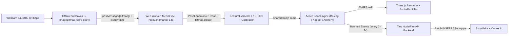

# Webcam Motion Sports (2026 Retro Remix) — Hackathon Research & Build Plan

> **CRITICAL SCHEDULE & RULES CATCH (from KCL FirstYearHack slides):**
> The slides specify a **7-hour build** (`11:00` hacking starts → `17:30` soft deadline → `18:00` hard deadline; teams of up to 3; **Rule 01: Build with JetBrains Air (required)**; Track 02: *Retro Remix — Old Tech, New Tricks*; Sponsor Prize: *Best Use of Snowflake*, highlighting free datasets, Cortex Code CLI, or any Snowflake features). The cut list below covers **both** an Hour-12 (24h) and Hour-3.5 (7h) checkpoint.

---

## Executive Summary Table

*Scoring (1–5): **Tracking Reliability**, **2-Min Demo Fun**, and **Snowflake Data Richness** use `5 = best`. **Latency Sensitivity** uses `1 = very forgiving` to `5 = strict/punishing`. Effort estimates assume an MVP using a shared MediaPipe + Three.js core. Art and characters must be 100% original (zero Nintendo/Wii/Mii likeness).*

| Rank | Sport | Tracking Reliability (1–5) | 2-Min Demo Fun (1–5) | Build Effort (hrs) | Latency Sensitivity (1–5) | Snowflake Data Richness (1–5) | Key Metrics Produced | Verdict |
| :--- | :--- | :---: | :---: | :---: | :---: | :---: | :--- | :--- |
| **1** | **Boxing** *(locked)* | **4** | **5** | 3–4 h | 3 | **5** | Punch class (jab/cross/hook/uppercut), peak wrist velocity, reaction ms, guard %, dodge rate, L/R symmetry, fatigue decay | **Ship #1** |
| **2** | **Goalkeeper (Penalty Saves)** | **5** | **5** | 2–3 h | 3 | **5** | Kick-to-move reaction ms, 9-zone dive heatmap, reach efficiency, anticipation vs. reaction, L/R bias | **Ship #2** |
| **3** | **Archery** | **4** | **4** | 2.5–3.5 h | **1** | **5** | Aim-hold RMS micro-tremor, draw tension consistency, wind-compensation error (dx, dy), draw tempo | **Ship #3** |
| 4 | **Table Tennis** | 3 | 4 | 3–4 h | 5 | 4 | Rally length, forehand/backhand split, swing speed, timing offset (early/late ms) | Cut (too lag/blur sensitive) |
| 5 | **Fencing** | 3 | 4 | 3.5–4.5 h | 4 | 4 | Parry-to-riposte ms, lunge velocity, guard zone coverage, feint bite rate | Cut (side-stance self-occlusion) |
| 6 | **Bowling** | 2 | 4 | 4–5 h | 2 | 4 | Release speed, wrist hook angle, lane entry angle, pin-leave patterns | Cut (desk clips low swing + 10-pin physics) |
| 7 | **Tennis** | 2 | 3 | 4–5 h | 4 | 4 | Stroke mix, swing arc speed, contact timing offset, court coverage | Cut (needs wide swing space in labs) |
| 8 | **Golf** | 2 | 2 | 4–5 h | 1 | 4 | Backswing:downswing tempo, peak speed proxy, swing-plane deviation | Cut (full-body FOV + slow demo pace) |

---

## 1. Candidate Sport Evaluation Notes

Constraints for a **single laptop webcam in a crowded university lab** (desk-level camera, overhead fluorescent lighting, 1.0–1.5 m distance, passersby in background):

- **Winners (Boxing, Goalkeeper, Archery):** Strictly **upper-body** (nose, shoulders, elbows, wrists), playable **seated or standing**, and contained inside a standard ~60° laptop webcam FOV without hitting teammates.
- **Why Bowling & Golf score 2/5 on tracking:** Both require dropping hands below hip/knee height; a laptop on a desk clips the swing arc unless the player stands ~2.5 m back (where passersby enter the frame). Bowling also requires tuning a 10-pin rigid-body physics engine (`cannon-es`/`rapier`).
- **Why Tennis & Table Tennis are risky:** Tennis needs wide lateral clearance; Table Tennis relies on fast wrist flicks that blur on 30 FPS webcams and expose 70–100 ms ML inference lag during fast rallies.
- **Why Fencing is risky:** Sideways stances cause rear-shoulder/arm self-occlusion in BlazePose, while lunges hit monocular Z-depth compression.

---

## 2. Recommended Trio to Ship: Boxing + Goalkeeper + Archery

1. **Zero-Overlap Gameplay & Pacing:**
   - **Boxing:** High-energy explosive velocity + defence (45–60 s bout).
   - **Goalkeeper:** Pure 2D X–Y reflex positioning — **zero Z-depth ambiguity** and the highest-reliability demo fallback if venue lighting degrades.
   - **Archery:** Calm precision & steadiness — **zero latency sensitivity** and a direct showcase for 1€ Filter smoothing.
2. **No Heavy Physics Engine Needed:** All three run on analytical Three.js math (swept sphere/capsule hitboxes + parabolic gravity/wind kinematics), avoiding rigid-body physics bugs.
3. **Cohesive "2026 Athlete Profile" in Snowflake:** Measures three orthogonal axes — **Power & Endurance (Boxing)**, **Reflex & Spatial Coverage (Goalkeeper)**, and **Precision & Stability (Archery)** — giving Snowflake Cortex rich cross-sport data to coach on.
4. **Original Aesthetic (Zero Nintendo/Wii/Mii Likeness):** Use a **Cyber-Arcade / Kinetic Lab** style — glowing geometric floating gloves, holographic visor-drone opponents, neon laser goal frames, and low-poly energy bows.

*(7-hour reality check: Lock **Boxing + Goalkeeper** as the core 2-sport shippable MVP; add **Archery** only once Snowflake ingestion + Cortex Coach work end-to-end.)*

---

## 3. Build Recipes for the Top 3 Sports

### Shared Camera Calibration (2-Second "Hold Stance" Gate)
Run once on entering a sport (average 15 valid frames where shoulder `visibility > 0.5`):
- **Mirror X:** `x = 1 - landmark.x` so movement matches a mirror.
- **Scale Normalization:** Measure `shoulderWidth` `S = ||P_11 - P_12||_2D`. Express **all** displacements and velocities in **shoulder-widths per second (`SW/s`)** so seated (0.8 m) and standing (1.8 m) players trigger identically.
- **Origin Anchors:** Store `torsoCenter` `C = (P_11 + P_12) / 2` and neutral nose `N_0 = P_0`.
- **Smoothing:** Apply a **1€ Filter** (`1eurofilter` npm package) per `(x, y, z)` coordinate on every tracked joint — dynamically raises cutoff speed during fast motion to eliminate lag while suppressing idle jitter ([Casiez et al., CHI 2012](https://gery.casiez.net/1euro/)).

### Sport 1: Boxing (*"Kinetic Ring"*)
- **Landmarks (`PoseLandmarker` only):** `0` (Nose), `11/12` (L/R Shoulders), `13/14` (L/R Elbows), `15/16` (L/R Wrists). Use both `poseLandmarks` (2D screen X–Y) and `poseWorldLandmarks` (3D metric meters for joint angles & Z-thrust).
- **Filter Tuning:** `minCutoff = 1.5 Hz`, `beta = 0.08`, `dCutoff = 1.0 Hz`.
- **Motion Detection Logic:**
  - *Elbow angle* `theta = angle(shoulder, elbow, wrist)` in 3D world space.
  - **Jab / Cross (Straight):** Never rely on raw Z alone. Trigger when **all** hold: `d(theta)/dt > 280 deg/s`, `theta > 140 deg`, world-Z forward delta `z_wrist - z_shoulder < -0.18 m`, and `220 ms` per-hand cooldown elapsed. Classify as **Cross** if shoulder twist `|z_11 - z_12| > 0.12 m`, else **Jab**.
  - **Hook:** Lateral speed `|v_x| > 2.2 SW/s` crossing torso midline while `70 deg < theta < 130 deg`.
  - **Uppercut:** Upward speed `v_y < -2.0 SW/s` (image Y points down) starting below shoulder line.
  - **Guard:** Both wrists within `0.45 SW` of nose AND `y_wrist < y_shoulder`.
  - **Slip / Duck:** `|x_0 - C_x| > 0.35 SW` (left/right slip) or `y_0 - N_0_y > 0.25 SW` (duck).
- **Rules & Three.js Physics:** 60 s round or 100 HP KO. First-person floating neon boxing gloves spring-lerp toward mapped wrist positions; opponent is a stylized segmented cyber-drone with glowing chest/head hit spheres. Opponent telegraphs attacks (`600 ms` red ring charge -> strike); blocking cuts damage 80%, slipping opens a `1.5x` counter window. Add `40 ms` hitstop, camera shake, and spark particles on impact.

### Sport 2: Goalkeeper (*"Reflex Keeper"*)
- **Landmarks (`PoseLandmarker` only):** `11/12` (Shoulders), `15/16` (Wrists), `19/20` (Index tips; fallback to wrist if `visibility < 0.5`), `0` (Nose for body dive).
- **Filter Tuning:** `minCutoff = 1.2 Hz`, `beta = 0.12` (minimal lag for sudden reflex lunges).
- **Calibration Mapping:** Map reach box `x in [C_x - 1.4*S, C_x + 1.4*S]` -> Three.js goal width `[-3.66 m, +3.66 m]`, and `y in [C_y - 1.1*S, C_y + 0.5*S]` -> `[0.2 m, 2.44 m]`. Apply a mild power curve (`sign(u) * |u|^0.85`) near edges so seated players can reach top corners cleanly.
- **Rules & Three.js Physics:** 5-kick shootout (~50 s). Striker bot runs up (`0.5 s` subtle stance telegraph) and launches a ball toward a 9-zone goal grid with randomized spin `omega`. Step at 60 Hz with gravity + Magnus curve:
  - `a = g + k_M * (omega x v)`
  - `v += a * dt; p += v * dt`
  When `ball.z` crosses the goal plane, run swept sphere-to-sphere intersection against both keeper gloves (generous `0.38 m` arcade radius) and torso capsule. On save: reflect velocity with restitution `0.65` plus glove velocity vector for punch-clearances.

### Sport 3: Archery (*"Aero Bow"*)
- **Landmarks:** `PoseLandmarker` `0, 11, 12, 13, 14, 15, 16`. *(Keep `HandLandmarker` optional.)*
- **Filter Tuning:** Dual-regime 1€ filter — tighten to `minCutoff = 0.6 Hz`, `beta = 0.02` once drawn for a calm reticle; compute `RMS(raw_bow_wrist - filtered_bow_wrist)` over the final `0.8 s` to log **aim stability** to Snowflake.
- **Motion Detection Logic:**
  - **Auto Handedness:** Extended arm (`elbowAngle > 145 deg`) = **Bow Hand**; bent arm (`elbowAngle < 100 deg`) = **Draw Hand**.
  - **Draw Tension (`0–1`):** Normalize horizontal wrist distance `|x_bow - x_draw| / S` from `[0.5, 1.6]` -> `[0, 1]`. Arm the bow once `tension > 0.7` for `>= 250 ms`.
  - **Release Trigger (High-Reliability Default):** Default to **Pose-only release**: draw wrist snaps rapidly outward/backward (`|v_draw| > 1.8 SW/s`) OR drops quickly (`v_y > 1.5 SW/s`). Optionally layer `HandLandmarker` thumb-tip (`4`) to index-tip (`8`) pinch-release when close & well-lit.
- **Rules & Three.js Physics:** 5 arrows at a 10-ring target (`25 m` away); shots 4–5 add a visible wind flag (`a_wind` lateral acceleration) and slow target drift. Launch speed `v_0 = 28 + 22 * tension` (m/s). Integrate `v += (g + a_wind) * dt`, orient arrow mesh along velocity vector, and raycast `p_prev -> p_curr` against target plane (`z = -25`) for exact bullseye ring score (`10 - floor(r / ringWidth)`).

---

## 4. Client Architecture



- **Shared Pose Pipeline (`SportEngine` Pattern):** Initialize `PoseLandmarker` and `getUserMedia` **once** in a singleton `PosePipeline`. Every sport implements `{ init(scene, calibration), onPoseFrame(bodyFrame), update(dt), flushTelemetry(), dispose() }`. Switching sports takes `<100 ms` with zero WASM reload.
- **Web Worker Inference & Backpressure:** Transfer `ImageBitmap` objects to `pose.worker.ts` via `postMessage(msg, [bitmap])` and always call `bitmap.close()` inside the worker to prevent memory leaks. Use a strict **`isBusy` boolean gate** on the main thread — drop incoming webcam frames while the worker is busy rather than queuing them. Wrap `delegate: "GPU"` in `try/catch` with automatic fallback to `delegate: "CPU"` if worker WebGL2 `OffscreenCanvas` is unsupported.
- **Target FPS & Low-End Laptop Fallbacks:**
  - **Target:** `60 FPS` Three.js render loop + `25–30 FPS` inference using `pose_landmarker_lite` (`float16`, ~5 MB).
  - **Auto-Downgrade Ladder:** If average inference exceeds `45 ms` over 10 frames -> shrink capture canvas to `320x240`, clamp `renderer.setPixelRatio(1)`, disable shadows/bloom, and disable `HandLandmarker`.
  - **Emergency Demo Fallback:** Bind keyboard/mouse debug controls (`Space`/click = punch/release, mouse X–Y = keeper gloves/aim) behind a hotkey (`D`) for judging emergencies or webcam failures.
- **1v1 Option — WebRTC vs. Same-Screen:**
  - **Same-Screen (`numPoses: 2`):** Natively supported by MediaPipe (split players by torso X). Zero Wi-Fi dependency, *but* halves per-player FOV, crowds two people at one laptop, and adds ~30% inference latency.
  - **Two-Laptop WebRTC (`PeerJS` DataChannel):** Stream only `~120-byte` action/pose packets at 20 Hz (never video). Great FOV per player, *but* university `eduroam` Wi-Fi often blocks P2P UDP/STUN traversal.
  - **Recommended Choice:** Ship **1P vs. AI + "Beat the Ghost" Async 1v1** (replay the current Snowflake #1 player's timed score/pace live). If adding live 2-laptop 1v1, relay JSON packets through a **WebSocket on your existing backend** instead of raw WebRTC to avoid `eduroam` NAT blocks.

---

## 5. Snowflake Design ("Best Use of Snowflake")

### Core Table Schema
Log **semantic motion events + 5 Hz summary ticks** (not 60 Hz raw 33-joint dumps):

```sql
CREATE TABLE PLAYERS (
  player_id    STRING PRIMARY KEY,
  display_name STRING NOT NULL,
  created_at   TIMESTAMP_NTZ DEFAULT CURRENT_TIMESTAMP()
);

CREATE TABLE SESSIONS (
  session_id        STRING PRIMARY KEY,
  player_id         STRING,
  sport             STRING,           -- 'BOXING' | 'GOALKEEPER' | 'ARCHERY'
  started_at        TIMESTAMP_NTZ,
  ended_at          TIMESTAMP_NTZ,
  final_score       FLOAT,
  avg_inference_fps FLOAT,
  form_score        FLOAT,
  ai_coach_json     VARIANT
);

CREATE TABLE MOTION_EVENTS (
  event_id        STRING,
  session_id      STRING,
  player_id       STRING,
  sport           STRING,
  event_ts        TIMESTAMP_NTZ,
  round_ms        INTEGER,
  event_type      STRING,             -- 'PUNCH'|'BLOCK'|'DODGE'|'SAVE'|'GOAL'|'ARROW_RELEASE'|'TICK'
  peak_velocity   FLOAT,              -- shoulder-widths/sec
  reaction_ms     FLOAT,              -- ms from telegraph to response
  accuracy_score  FLOAT,              -- 0..100
  symmetry_ratio  FLOAT,              -- L/R balance 0..1
  metrics         VARIANT             -- sport-specific JSON: {punchType, elbowAngle, zone, rmsSway, windErrX}
);
```

### Browser Ingestion: Snowpipe Streaming vs. Small Backend API
**Never put Snowflake credentials in browser JS.** Send batched JSON arrays (`POST /api/events` every 2–3 s + on round end) to a tiny Node/Express or Python/FastAPI proxy:
- **Recommended for Hackathon — Small Backend API (`snowflake-sdk` / SQL API):** ~30 minutes to set up, supports both **multi-row batched `INSERT`** (sub-second queryability for instant post-match coaching) and `SELECT` queries for leaderboards and Cortex calls.
- **Snowpipe Streaming REST API:** Use only as a stretch upgrade if MVP is done early and you want to highlight high-throughput NDJSON streaming channels (~5 s latency).

### 4 High-Impact Analytics & Cortex Features
1. **Instant Post-Match AI Coach (`SNOWFLAKE.CORTEX.COMPLETE` / `AI_COMPLETE`):** On match end, SQL aggregates `MOTION_EVENTS` (e.g., *"right cross 26% faster than left jab, guard uptime dropped from 72% to 31% in final 15 s, missed 3 top-right shots"*) and calls `SNOWFLAKE.CORTEX.COMPLETE('llama3.1-70b', ...)` (or `claude-3-5-sonnet`) to return a structured JSON **Coach Card**: 3 specific biomechanical tips, 1 custom drill, and an original play-style badge.
2. **Biomechanics Form Score & Fatigue Decay (Dynamic Table + Window SQL):** A Snowflake **Dynamic Table** (`TARGET_LAG = '1 minute'`) computes Q1-vs-Q4 velocity drop-off (`NTILE(4)`), left/right symmetry, and a composite `0–100` Form Score across all matches, plus percentile ranks against a seeded `PRO_BENCHMARKS` table.
3. **Live Booth Decathlon Leaderboard & "Ghost Rival":** Real-time SQL view ranking judges and attendees across all 3 sports (Overall Kinetic Rating + Fastest Reflex ms + Best Bullseye Grouping).
4. **Companion Streamlit in Snowflake (SiS) Analytics Hub (+ Cortex Code CLI):** 1-page Streamlit dashboard inside Snowflake showing live goalkeeper 9-zone save heatmaps, archery shot dispersion scatter plots, boxing speed-over-time curves, and a natural-language *"Ask the Coach"* Cortex query box. Use **Cortex Code CLI** (highlighted on the sponsor slide) to scaffold DDL/queries.

---

## 6. Risks & Cut List

### Top Risks & Mitigations
| Risk | Impact | Mitigation |
| :--- | :--- | :--- |
| **Background passersby hijack pose tracking** | High (broken demo) | Set `numPoses: 1` (or select largest `shoulderWidth` closest to frame center) and ignore landmarks with `visibility < 0.5`. |
| **Harsh/backlit lab lighting ruins finger tracking** | Medium | Make all 3 sports **100% playable on `PoseLandmarker` alone**; treat `HandLandmarker` as optional. |
| **Snowflake warehouse cold start (`3–8 s`) during judging** | Medium | Keep an `X-SMALL` warehouse warm (`AUTO_SUSPEND = 300`) during judging; show an "AI Coach Analyzing Form..." animation while `CORTEX.COMPLETE` runs. |
| **Forgetting mandatory hackathon rules** | Fatal | Build inside **JetBrains Air** (Rule 01) and submit draft by **17:30** (`18:00` hard cutoff). |

### Prioritized Cut List (Drop Top-to-Bottom When Behind)
*Check at **Hour 12** (24h plan) or **14:30 / Hour 3.5** (actual 7h KCL FirstYearHack schedule):*

1. **Cut #1:** Live 2-laptop 1v1 (WebRTC/WebSockets) and `numPoses: 2` split-screen. Keep 1P vs. AI + Snowflake leaderboard.
2. **Cut #2:** `HandLandmarker` model. Keep `PoseLandmarker` Lite only.
3. **Cut #3:** Snowpipe Streaming REST API. Use batched multi-row `INSERT` via the backend API (keeps Snowflake schema + Cortex AI intact).
4. **Cut #4:** Sport #3 (**Archery**). Two polished sports (**Boxing + Goalkeeper**) with juicy Three.js feedback + working Snowflake Cortex Coach & Streamlit dashboard will beat three janky sports.
5. **Cut #5 (Hard Floor — Never Cut):** Keep **Boxing (webcam + keyboard fallback) + Snowflake `MOTION_EVENTS` ingestion + live Cortex AI Coach summary + Leaderboard**.

---

## Sources & References

- **MediaPipe Pose Landmarker (Web/JS & 33 Landmarks):** [Google AI Edge MediaPipe Docs](https://ai.google.dev/edge/mediapipe/solutions/vision/pose_landmarker/web_js) · [`@mediapipe/tasks-vision` (npm)](https://www.npmjs.com/package/@mediapipe/tasks-vision)
- **MediaPipe Hand Landmarker (Web/JS):** [Google AI Edge Hand Landmarker Docs](https://ai.google.dev/edge/mediapipe/solutions/vision/hand_landmarker/web_js)
- **BlazePose Architecture Paper:** Bazarevsky et al., *BlazePose: On-device Real-time Body Pose tracking* (2020) — [arXiv:2006.10204](https://arxiv.org/abs/2006.10204)
- **1€ Filter (Smoothing Without Lag):** Casiez, Roussel & Vogel (CHI 2012) — [Project Page & Paper](https://gery.casiez.net/1euro/) · [Official GitHub (`casiez/OneEuroFilter`)](https://github.com/casiez/OneEuroFilter) · [TypeScript npm (`1eurofilter`)](https://www.npmjs.com/package/1eurofilter)
- **Web Workers & Zero-Copy Frame Transfer:** [MDN `OffscreenCanvas`](https://developer.mozilla.org/en-US/docs/Web/API/OffscreenCanvas) · [MDN `ImageBitmap`](https://developer.mozilla.org/en-US/docs/Web/API/ImageBitmap)
- **Three.js + MediaPipe Reference Repos:** [`bandinopla/three-mediapipe-rig`](https://github.com/bandinopla/three-mediapipe-rig) · [`pmmathias/birdybird`](https://github.com/pmmathias/birdybird) · [Three.js Docs](https://threejs.org/docs/)
- **WebRTC 1v1 Option:** [PeerJS](https://peerjs.com/)
- **Snowflake Ingestion, Analytics & Cortex:**
  - [Snowpipe Streaming Overview](https://docs.snowflake.com/en/user-guide/data-load-snowpipe-streaming-overview) & [High-Performance REST API](https://docs.snowflake.com/en/user-guide/snowpipe-streaming/snowpipe-streaming-high-performance-rest-api)
  - [Snowflake SQL REST API](https://docs.snowflake.com/en/developer-guide/sql-api/index)
  - [Snowflake Cortex LLM Functions (`COMPLETE` / `AI_COMPLETE`)](https://docs.snowflake.com/en/user-guide/snowflake-cortex/llm-functions)
  - [Snowflake Dynamic Tables](https://docs.snowflake.com/en/user-guide/dynamic-tables-about)
  - [Streamlit in Snowflake](https://docs.snowflake.com/en/user-guide/streamlit/about-streamlit)
